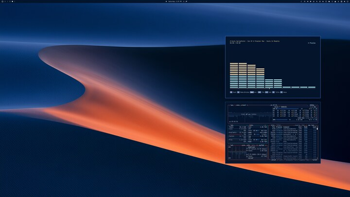
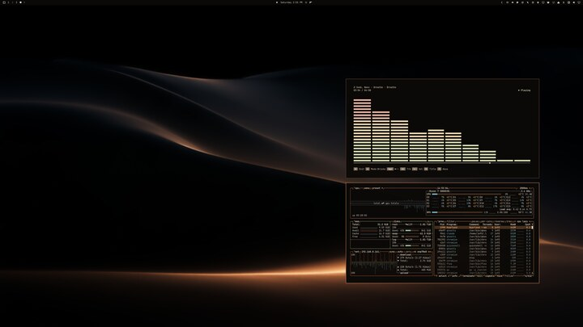
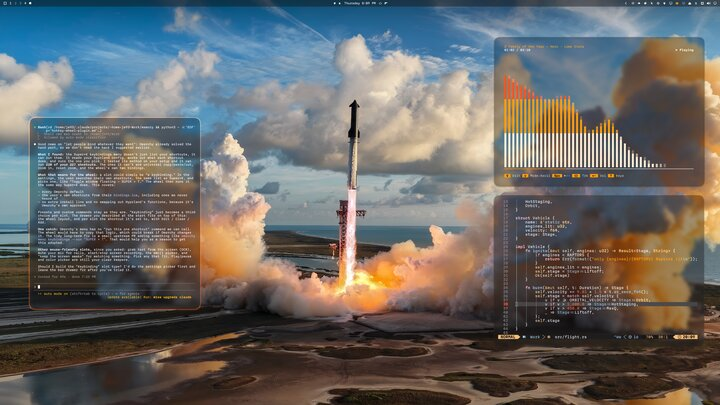
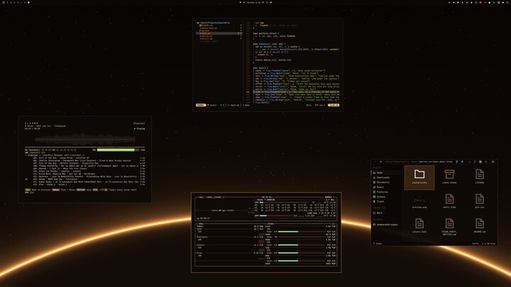
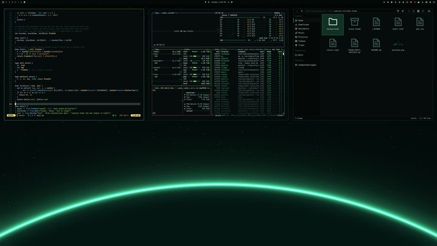
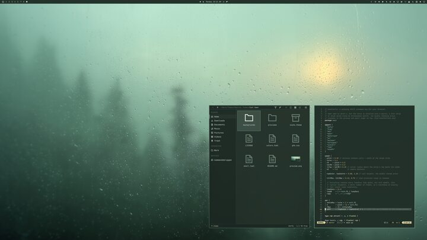
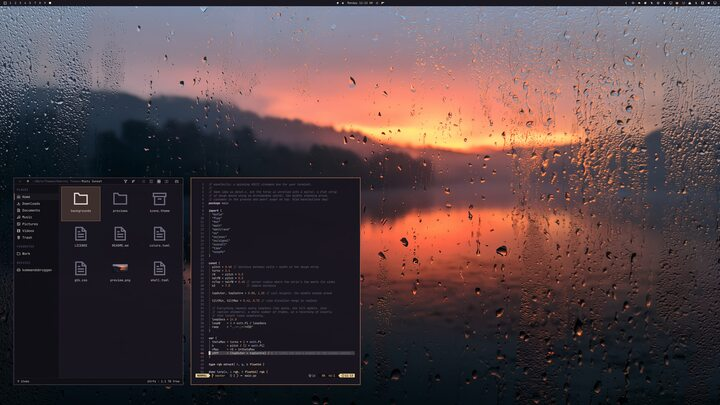
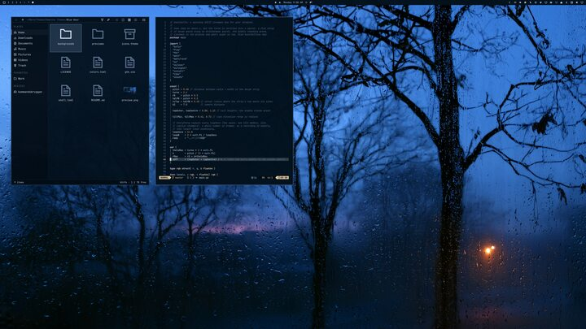
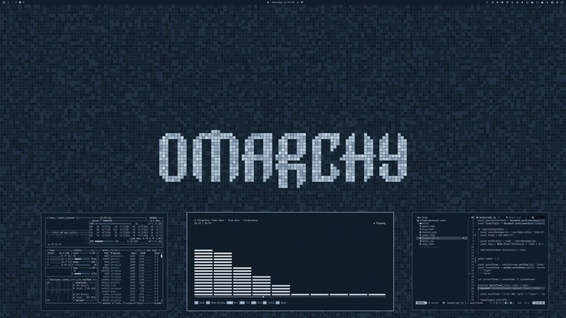
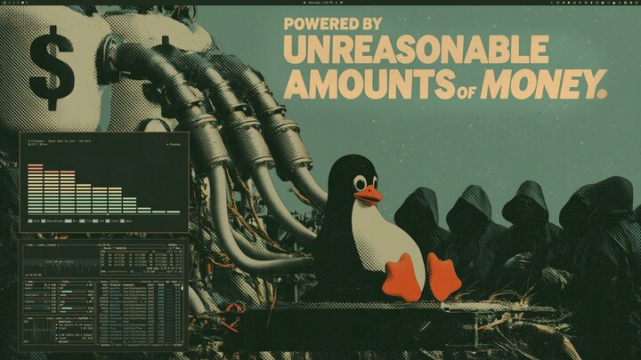

# Hey, I’m Erik 👋

A Swedish dabbler in all sorts. I’m currently deep down in the Omarchy rabbit hole and have been so ever since the day I first installed it (462 days ago). I therefore spend most of my time creating Omarchy themes or silly plugins for my own desktop, then share them in case someone else enjoys them too.

## 🧩 Plugins & desktop toys

- [Hotkey Wheel](https://github.com/erikrjohansson/omarchy-hotkey-wheel) — A mouse-driven action wheel: hold middle-click, flick and release to run any app, Omarchy action, keybinding or your own custom command.
- [Koi Screensaver](https://github.com/erikrjohansson/koi-screensaver) — A custom and cozy screensaver where the Omarchy logo transforms into swimming koi.
- [Extended Theme Picker](https://github.com/erikrjohansson/omarchy-extended-theme-picker) — An extended theme picker for people like me who have way too many themes installed and want some easier organization.
- [Extended Keybindings Viewer](https://github.com/erikrjohansson/omarchy-extended-keybindings-viewer) — An extended keybindings viewer with more of a visual way of exploring the Omarchy with your keyboard or mouse.
- [Theme Favorites](https://github.com/erikrjohansson/omarchy-theme-favorites) — find out which Omarchy themes you actually use most, per week, per month, year and all time.
- [Blow Off Some Steam](https://github.com/erikrjohansson/blow-off-some-steam) — a fun game for when you’re bored, angry or just waiting for your agents to finish.
- [OmaMap](https://github.com/erikrjohansson/omamap) — track the countries you’ve visited in a interactive map.

## 🎨 Themes

Click a preview to explore the theme.

<table>
  <tr>
    <td align="center" width="50%"><a href="https://github.com/erikrjohansson/omarchy-cobalt-dunes-theme"> <strong>Cobalt Dunes</strong></a></td>
    <td align="center" width="50%"><a href="https://github.com/erikrjohansson/omarchy-ember-dunes-theme"> <strong>Ember Dunes</strong></a></td>
  </tr>
  <tr>
    <td align="center" width="50%"><a href="https://github.com/erikrjohansson/omarchy-sumi-day-theme"> <strong>Sumi Day</strong></a></td>
    <td align="center" width="50%"><a href="https://github.com/erikrjohansson/omarchy-sumi-night-theme"> <strong>Sumi Night</strong></a></td>
  </tr>
  <tr>
    <td align="center" width="50%"><a href="https://github.com/erikrjohansson/omarchy-starship-to-orbit-theme"> <strong>Starship To Orbit</strong></a></td>
    <td align="center" width="50%"><a href="https://github.com/erikrjohansson/omarchy-norrsken-amber-theme"> <strong>Norrsken Amber</strong></a></td>
  </tr>
  <tr>
    <td align="center" width="50%"><a href="https://github.com/erikrjohansson/omarchy-norrsken-theme"> <strong>Norrsken</strong></a></td>
    <td align="center" width="50%"><a href="https://github.com/erikrjohansson/omarchy-cool-dawn-theme"> <strong>Cool Dawn</strong></a></td>
  </tr>
  <tr>
    <td align="center" width="50%"><a href="https://github.com/erikrjohansson/omarchy-misty-sunset-theme"> <strong>Misty Sunset</strong></a></td>
    <td align="center" width="50%"><a href="https://github.com/erikrjohansson/omarchy-blue-hour-theme"> <strong>Blue Hour</strong></a></td>
  </tr>
  <tr>
    <td align="center" width="50%"><a href="https://github.com/erikrjohansson/omarchy-midnight-slate-dark-mosaic-theme"> <strong>Mosaic Collection</strong></a> <a href="https://github.com/erikrjohansson/omarchy-pine-ivory-mosaic-theme">Pine Ivory</a> · <a href="https://github.com/erikrjohansson/omarchy-black-gold-mosaic-theme">Black Gold</a> · <a href="https://github.com/erikrjohansson/omarchy-petrol-champagne-mosaic-theme">Petrol Champagne</a> · <a href="https://github.com/erikrjohansson/omarchy-charcoal-copper-mosaic-theme">Charcoal Copper</a> · <a href="https://github.com/erikrjohansson/omarchy-blue-mosaic-theme">Blue</a> · <a href="https://github.com/erikrjohansson/omarchy-green-mosaic-theme">Green</a> · <a href="https://github.com/erikrjohansson/omarchy-midnight-slate-dark-mosaic-theme">Midnight Slate Dark</a> · <a href="https://github.com/erikrjohansson/omarchy-black-white-mosaic-theme">Black White</a></td>
    <td align="center" width="50%"><a href="https://github.com/erikrjohansson/oligarchy-theme"> <strong>Oligarchy</strong></a></td>
  </tr>
</table>
